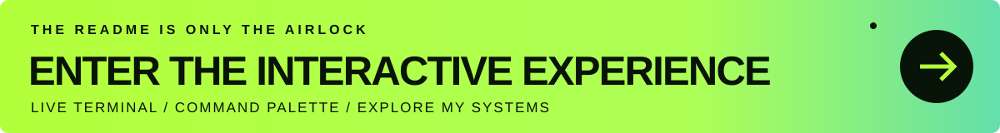

<picture>
  <source media="(max-width: 700px)" srcset="./assets/hero-mobile-v2.svg">
  
</picture>

 

### THE CODE IS THE EASY PART. THE SYSTEM IS THE CHALLENGE.

**Backend engineer** building APIs, multi-tenant products, commerce infrastructure and integrations with **PHP / Laravel**.

 

 

**[↗ LAUNCH EXPERIENCE](https://alielbialy4.github.io/)** &nbsp;·&nbsp; **[⌘ OPEN TERMINAL](https://alielbialy4.github.io/#console)** &nbsp;·&nbsp; **[◈ EXPLORE SYSTEMS](https://alielbialy4.github.io/#work)**

GitHub READMEs can't execute JavaScript. The linked portfolio is where the real interaction happens.

---

### 01 / WHAT I ENGINEER

<table>
<tr>
<td width="33%" valign="top">

**◈ COMMERCE SYSTEMS**

POS / ERP · Multi-branch operations · Stock · Orders · Payments

</td>
<td width="33%" valign="top">

**⬡ SAAS PLATFORMS**

Tenant isolation · Secure APIs · RBAC · Data boundaries

</td>
<td width="33%" valign="top">

**↗ CONNECTED PRODUCTS**

OAuth · Webhooks · External APIs · Queues · Realtime

</td>
</tr>
</table>

### 02 / THE STACK

  

<code>BACKEND FIRST</code> &nbsp; <code>BUSINESS CORRECTNESS</code> &nbsp; <code>API DESIGN</code> &nbsp; <code>SYSTEM THINKING</code>

### 03 / UNLOCK THE ENGINEERING BRIEF

<b>▸ CLICK TO DECRYPT / HOW I THINK</b>

 

> **Think beyond the happy path.** Reliable software needs clear boundaries, predictable transactions, secure access and observable failures.

| Mindset | What it means |
| :-- | :-- |
| **01 — Domain first** | Model the business rule before choosing a framework trick. |
| **02 — Boundaries matter** | Tenant, branch and permission checks need to be explicit. |
| **03 — Failure is normal** | Design external calls, retries and background jobs deliberately. |
| **04 — Maintainability wins** | Build systems that other engineers can confidently evolve. |

<b>▸ CLICK TO DECRYPT / FIND PUBLIC CODE</b>

 

Selected public code and repositories:

- [**Graduation Project — Backend**](https://github.com/alielbialy4/graduation_project_back)
- [**Graduation Project — Frontend**](https://github.com/alielbialy4/graduation_project)
- [**All public repositories**](https://github.com/alielbialy4?tab=repositories)

Most commercial product code is private. This profile intentionally doesn't expose client repositories or implementation details.

<b>▸ CLICK TO DECRYPT / CONTACT CHANNEL</b>

 

**Got a tough backend problem?** I enjoy discussing product architecture, complex workflows and integrations.

[**↗ START A CONVERSATION**](mailto:ali.elmetwaly.dev@gmail.com?subject=Hello%20Ali) · [**↗ VISIT MY INTERACTIVE PORTFOLIO**](https://alielbialy4.github.io/)

---

**BUILD WITH CURIOSITY. SHIP WITH INTENTION.**

Designed for engineers who care about how things work beneath the surface.

