<div align="center">

<picture>
  <source media="(max-width: 700px)" srcset="./assets/hero-mobile.svg">
  
</picture>

<br>

[](https://github.com/alielbialy4)
[](https://github.com/alielbialy4?tab=repositories)


</div>

<br>

## 👋 More than endpoints. I build the systems behind products.

I'm **Ali Elbialy**, a backend-focused software engineer working with **PHP and Laravel** to turn complex business processes into dependable software.

My favorite problems live where **architecture meets real-world operations**: branch-aware commerce, inventory and finance workflows, multi-tenant systems, secure access, and integrations that need to keep working after launch.

> **My approach:** understand the business rule, design the boundaries, then make the implementation reliable, observable, and maintainable.

<br>

## ⚡ What I build

<table>
<tr>
<td width="33%" valign="top">

### 🧠 Backend Architecture
**The foundation of scalable products.**

- REST APIs & service boundaries
- Multi-tenancy & data isolation
- Authentication, permissions & RBAC
- Background jobs & event-driven flows

</td>
<td width="33%" valign="top">

### 🛒 Commerce & Operations
**Where software meets business reality.**

- POS / ERP workflows
- Multi-branch operations
- Inventory & financial reporting
- Order and payment lifecycles

</td>
<td width="33%" valign="top">

### 🔗 Integrations
**Making different systems work as one.**

- OAuth & external APIs
- Payments & webhooks
- Notifications & real-time features
- Cloud storage & service integrations

</td>
</tr>
</table>

<br>

## 🧰 Engineering toolkit

<div align="center">

**Core technologies**


<br><br>


</div>

<br>

## 🧭 How I think about engineering

```text
Business requirements
        │
        ▼
Domain rules & clear boundaries
        │
        ▼
Secure APIs + predictable data flows
        │
        ▼
Observability + maintainability
        │
        ▼
Software that teams can confidently evolve
```

<details>
<summary><b>🔍 Principles I keep coming back to</b></summary>

<br>

- **Business correctness first:** an elegant API means little if the underlying transaction is wrong.
- **Explicit access boundaries:** permissions and tenant/branch scoping should never be accidental.
- **Think in failure modes:** retries, idempotency, concurrency, and external-service failures matter.
- **Design for the next engineer:** readable code and clear ownership beat clever shortcuts.
- **Keep learning:** architecture, infrastructure, and security are continuous disciplines.

</details>

<br>

## 📈 GitHub activity

<div align="center">
  
  <br>
  
  
</div>

<sub>GitHub visualizations are generated by third-party services and may not reflect private engineering work.</sub>

<br><br>

## 🚀 Explore my work

Some of the most interesting engineering problems I work on are in private product repositories. For code that is public, you can explore my [repositories](https://github.com/alielbialy4?tab=repositories), including my [graduation project frontend](https://github.com/alielbialy4/graduation_project) and [backend](https://github.com/alielbialy4/graduation_project_back).

I enjoy exchanging ideas about **backend architecture, product engineering, APIs, and practical system design**.

<div align="center">

<br>

[](https://github.com/alielbialy4?tab=repositories)

<br><br>


</div>
